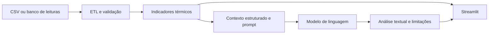

# Análise Térmica Industrial com LLM

> Portfólio técnico para demonstrar o uso responsável de inteligência artificial em um problema real de monitoramento industrial.

**Status:** estrutura pública do portfólio preparada. A integração funcional com os scripts originais deve ser verificada antes de afirmar que a demonstração está pronta.

## 1. Problema

O monitoramento de pré-aquecimento de água industrial produz séries temporais de temperatura, vazão e estados operacionais. Transformar essas leituras em diagnósticos interpretáveis exige tratamento de dados, indicadores e contexto do processo.

## 2. Objetivo

Explorar o uso de um LLM para **explicar indicadores calculados previamente**, apontar anomalias e produzir um relatório técnico com rastreabilidade. O LLM não substitui o cálculo determinístico, a validação dos dados nem a supervisão humana.

## 3. Arquitetura



Este é o **fluxo conceitual**. As chamadas reais entre os arquivos precisam ser confirmadas após revisar o código-fonte.

## 4. Componentes herdados

| Arquivo original | Responsabilidade sugerida pelo nome (a confirmar no código) |
| --- | --- |
| `etl_monitoramento.py` | Leitura e preparação de dados |
| `function_monitoramento.py` | Funções de apoio e indicadores |
| `exploratoria_monitoramento.py` | Análise exploratória |
| `inteligencia_monitoramento.py` | Lógica de inteligência e/ou LLM |
| `streamlit_app.py` | Interface do usuário |
| `teste_openai.py` | Experimento de conexão com o modelo (revisar antes de publicar) |
| `requirements.txt` | Dependências Python |

Os arquivos `.py` **não estão incluídos neste pacote**: copie-os apenas depois de revisar credenciais, dados sensíveis, caminhos locais e dependências.

## 5. Dados e demonstração

`data/amostra_leituras.csv` contém **dados sintéticos**, somente para documentação, testes básicos e demonstração após adaptar a leitura do projeto. Não são dados de produção nem evidência de desempenho do sistema real.

Os cálculos térmicos devem permanecer auditáveis. Por exemplo, `delta_t = temperatura_saida - temperatura_entrada`, considerando unidades em °C.

## 6. Executar em Windows (após inserir os scripts originais)

```powershell
py -m venv .venv
.\.venv\Scripts\Activate.ps1
python -m pip install --upgrade pip
pip install -r requirements.txt
Copy-Item .env.example .env
# Configure a chave no .env local (nunca publique esse arquivo)
streamlit run streamlit_app.py
```

**Atenção:** o código original pode exigir um nome/caminho específico para o CSV ou outras configurações. Se não conseguir abrir a amostra sem alterações, ajuste o caminho de leitura no código em vez de publicar o CSV real.

## 7. Avaliar a IA

Consulte [`docs/AVALIACAO_IA.md`](docs/AVALIACAO_IA.md). Toda conclusão gerada pelo modelo deve ser apoiada em dados fornecidos, sem inventar medições, resultados ou economia financeira.

## 8. Demonstrar o resultado

Veja o roteiro em [`docs/DEMONSTRACAO.md`](docs/DEMONSTRACAO.md). Acrescente capturas reais e um vídeo de curta duração **somente depois de executar a aplicação**.

## 9. Segurança e privacidade

- Nunca publique `.venv/.env`, `.venv`, `.idea`, chaves de API, senhas, IPs internos ou dados reais não autorizados.
- Use um repositório público **novo e sem histórico importado** do projeto privado.
- Revise os scripts e os resultados gerados por LLM antes da publicação.

## 10. Relação com o TCC

O monitoramento térmico é o projeto-base. Este repositório documenta a aplicação de LLM à interpretação de seus indicadores. O repositório completo do TCC pode permanecer privado.

**Autor:** Jean Koerich  
**Contexto:** Portfólio acadêmico e profissional
