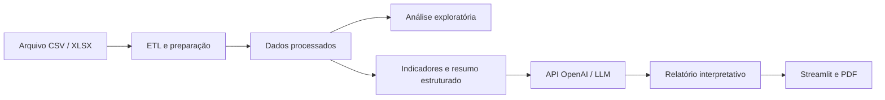

# Análise Térmica Industrial com LLM

**Aplicação em Python e Streamlit que transforma indicadores de monitoramento térmico industrial em análises e relatórios interpretativos com apoio de um modelo de linguagem (LLM).**

> Projeto de portfólio desenvolvido a partir de um sistema acadêmico de monitoramento do pré-aquecimento de água industrial.

## 1. Contexto e problema

O monitoramento de pré-aquecimento de água industrial produz registros de temperatura, vazão, energia e estados operacionais. Esses dados precisam ser tratados e contextualizados para apoiar a análise do desempenho térmico e a identificação de inconsistências.

A proposta é conectar **engenharia de dados, análise exploratória e IA generativa** em um único fluxo, sem atribuir ao LLM a responsabilidade pelos cálculos numéricos.

## 2. O que a aplicação implementa

- **ETL:** importação de arquivos CSV ou XLSX e preparação das leituras com Python e Pandas.
- **Análise exploratória:** consulta de indicadores, comportamento das variáveis e filtros por período.
- **Interpretação com IA:** envio de um resumo estruturado dos indicadores à API da OpenAI para elaboração de relatórios.
- **Relatórios:** formatos técnico, executivo e acadêmico, com exibição no Streamlit e exportação em PDF.

**Status:** o fluxo de processamento e a chamada à API estão implementados no código. A execução ponta a ponta com a base de demonstração e os cenários de avaliação ainda precisam de validação; não há resultados de desempenho da IA publicados neste repositório.

## 3. Arquitetura



Os indicadores são processados em Python; o LLM recebe os dados consolidados e gera **interpretação em linguagem natural**. A saída do modelo pode conter erros e deve ser revisada antes do uso para decisões operacionais.

## 4. Tecnologias

| Tecnologia | Aplicação |
| --- | --- |
| Python | Processamento e lógica da aplicação |
| Pandas | Preparação de dados e indicadores |
| Streamlit | Interface e navegação |
| Plotly | Visualizações da análise exploratória |
| OpenAI API | Geração de relatórios interpretativos com LLM |
| ReportLab | Exportação de relatórios em PDF |

## 5. Organização do código

| Arquivo | Responsabilidade |
| --- | --- |
| `streamlit_app.py` | Entrada da interface e navegação entre as páginas |
| `etl_monitoramento.py` | Upload e preparação da base de dados |
| `function_monitoramento.py` | Funções auxiliares, tratamento de dados e PDF |
| `exploratoria_monitoramento.py` | Análise exploratória e visualizações |
| `inteligencia_monitoramento.py` | Indicadores, construção do contexto, chamada ao LLM e exibição do relatório |
| `requirements.txt` | Dependências do ambiente Python |

## 6. Execução local (Windows / PowerShell)

Pré-requisitos: Python compatível com `requirements.txt` e uma chave de API válida para usar a geração de relatórios com IA.

```powershell
# Clonar o repositório
git clone https://github.com/JeanKoerich/analise-termica-llm.git
cd analise-termica-llm

# Preparar o ambiente
py -m venv .venv
.\.venv\Scripts\Activate.ps1
python -m pip install -r requirements.txt

# Criar configuração local (não publicar credenciais)
Copy-Item .env.example .env
# Preencha OPENAI_API_KEY no arquivo .env

# Iniciar a aplicação
python -m streamlit run streamlit_app.py
```

Na interface, importe e processe uma base pela página **ETL** antes de acessar **Análise Exploratória** ou **Relatório com IA**. A aplicação utiliza os dados processados armazenados na sessão do Streamlit.

**Compatibilidade dos dados:** o código atual utiliza, entre outras, a coluna `dt_registro` e medidas com prefixo `nr_`. O arquivo `data/amostra_leituras.csv` contém dados **sintéticos**, com nomes de colunas diferentes, e ainda precisa ser adaptado para demonstrar o fluxo completo. Não é uma base de produção.

**Configuração do modelo:** o identificador de modelo está definido em `MODELO_OPENAI`, no arquivo `inteligencia_monitoramento.py`. Verifique sua disponibilidade e permissões de acesso antes de executar a funcionalidade de IA.

## 7. Uso responsável da IA

- Os cálculos são realizados pela aplicação; o modelo atua na interpretação dos resultados fornecidos.
- As respostas são geradas a partir de contexto estruturado, não de uma leitura independente dos sensores.
- Não publicar chaves da API, dados industriais sensíveis ou arquivos `.env`.
- Validar as conclusões geradas e distinguir dados medidos, estimativas e interpretações.
- Revisar relatórios antes de utilizá-los em qualquer decisão operacional.

## 8. Origem do projeto

Este repositório reúne a camada de análise de dados e IA construída a partir do **TCC de monitoramento térmico industrial**. O projeto-base contempla a aquisição e o monitoramento de variáveis do pré-aquecimento de água; o código e a infraestrutura completos do TCC podem permanecer em repositório privado.

**Autor:** Jean Koerich  
**Contexto:** Portfólio acadêmico e profissional em Engenharia de Dados e Inteligência Artificial aplicada.